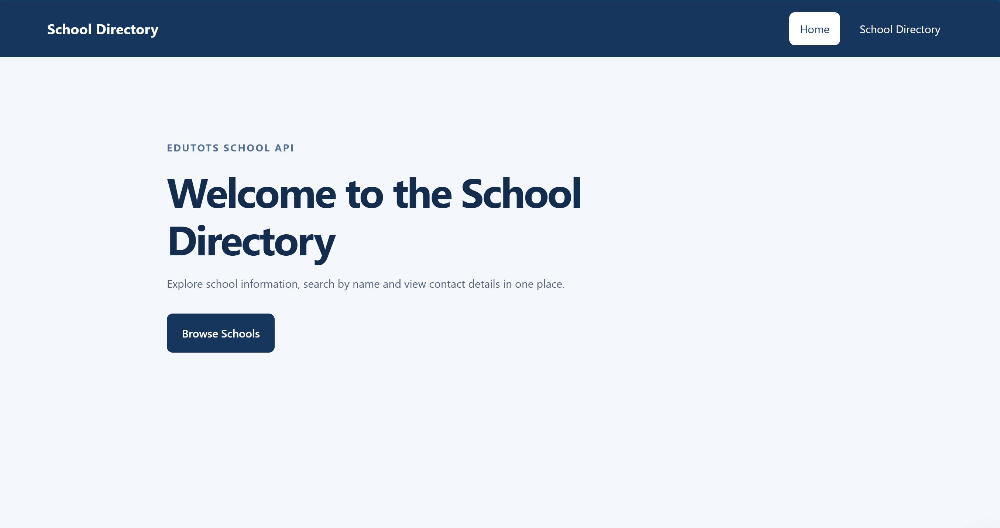
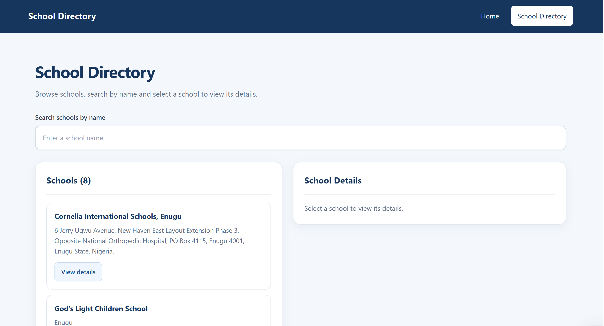
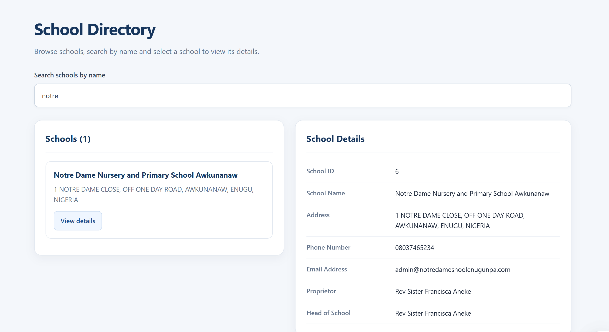
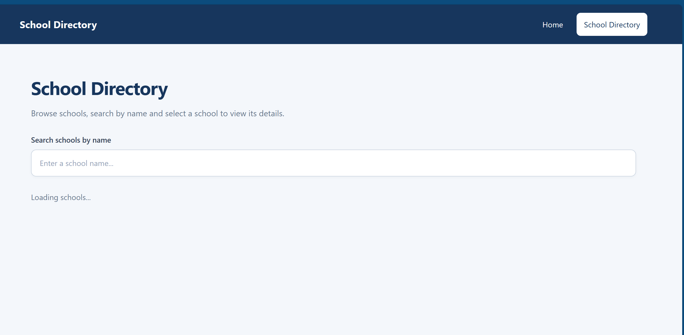
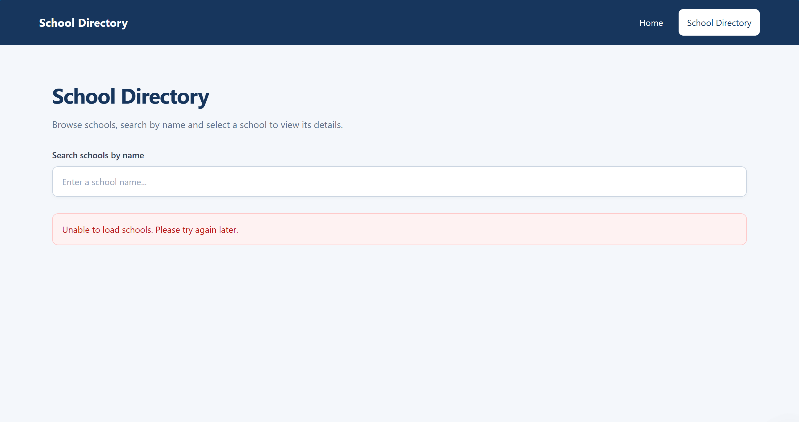

# School Directory Dashboard

## Overview

The School Directory Dashboard is a Blazor web application developed for the Full Stack Development 1 CA1 assignment. It consumes the Edutots School API and displays school information in an interactive interface.

Users can browse schools, search by name and select a school to view its details.

## Technologies

- C#
- Blazor Web App
- .NET 8
- Razor components
- HTML and CSS
- HttpClient
- System.Net.Http.Json
- Git and GitHub

## API

The application retrieves school data from the Edutots School API.

**Endpoint:** https://edutots.net/api/school

The JSON response is deserialized into C# School objects using GetFromJsonAsync.

## Features

- Displays schools retrieved from the API.
- Filters schools by name as the user types.
- Performs case-insensitive searches.
- Displays the selected school's ID, name, address, phone number, email address, proprietor and head of school.
- Uses reusable SchoolCard and SchoolDetails Razor components.
- Uses Parameter and EventCallback<School> for component communication.
- Displays a loading message while retrieving data.
- Handles API errors with a user-friendly message.
- Provides a home page and school directory navigation.

## Project Structure

```text
SchoolDirectory/
├── Components/
│   ├── Layout/
│   │   └── MainLayout.razor
│   ├── Pages/
│   │   ├── Home.razor
│   │   └── Schools.razor
│   ├── SchoolCard.razor
│   └── SchoolDetails.razor
├── Models/
│   └── School.cs
├── Services/
│   └── SchoolService.cs
├── wwwroot/
│   └── app.css
└── Program.cs
```

## How to Run the Application

### Requirements

- Visual Studio 2022
- .NET 8 SDK
- Internet connection to access the API

### Visual Studio

1. Open SchoolDirectory.sln in Visual Studio 2022.
2. Restore NuGet packages if required.
3. Set SchoolDirectory as the startup project.
4. Run the application using HTTPS.
5. Open the School Directory page from the navigation menu.

### .NET CLI

Run these commands from the repository root:

```powershell
dotnet restore .\SchoolDirectory\SchoolDirectory.csproj
dotnet run --project .\SchoolDirectory\SchoolDirectory.csproj
```

Open the local URL displayed in the terminal.

## Screenshots

Place the application screenshots in the `screenshots` folder using the filenames below.

### Home Page



### Dashboard



### School Directory


### Search Results and Details



### Loading State



### Error Handling


